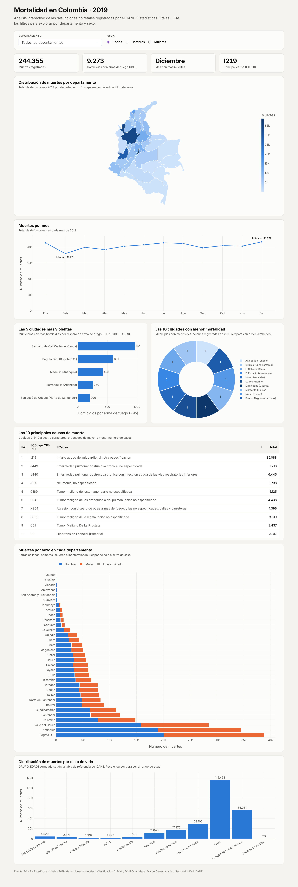
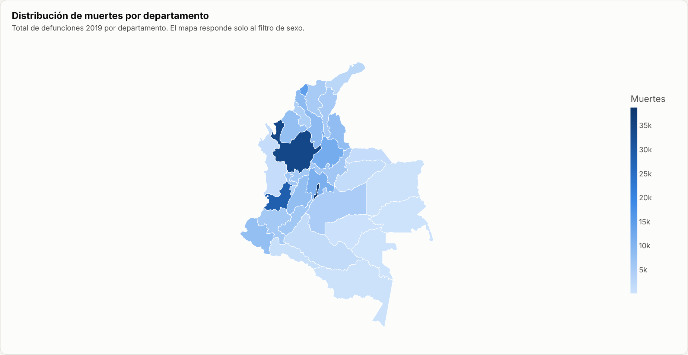
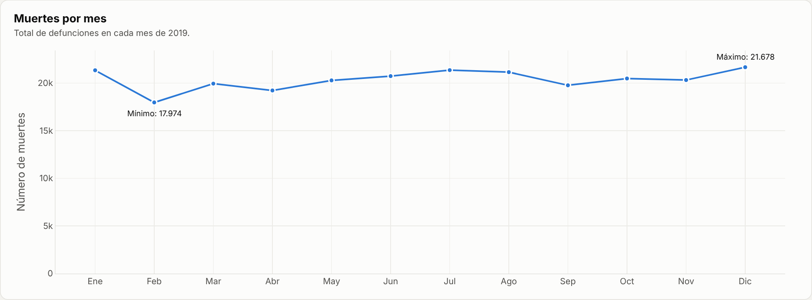
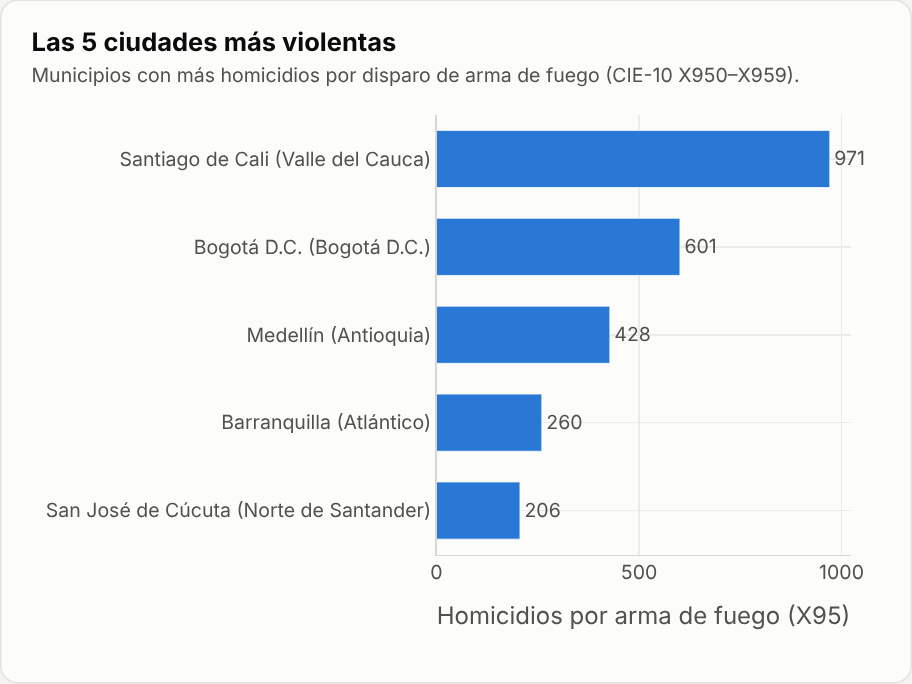
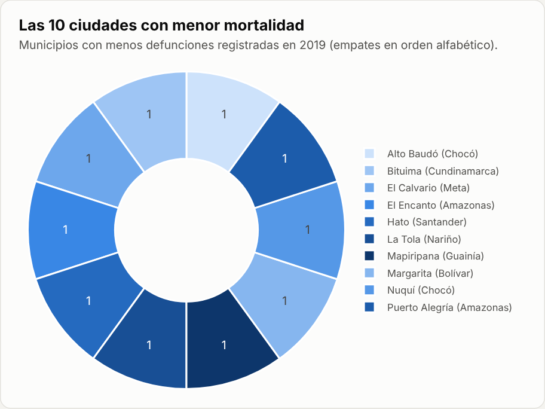
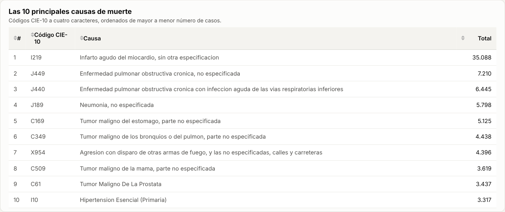
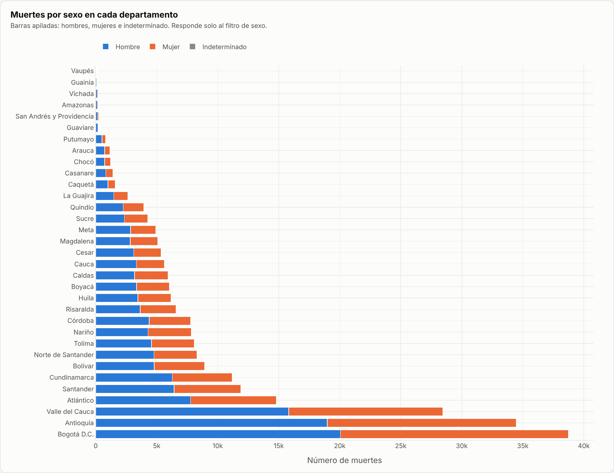
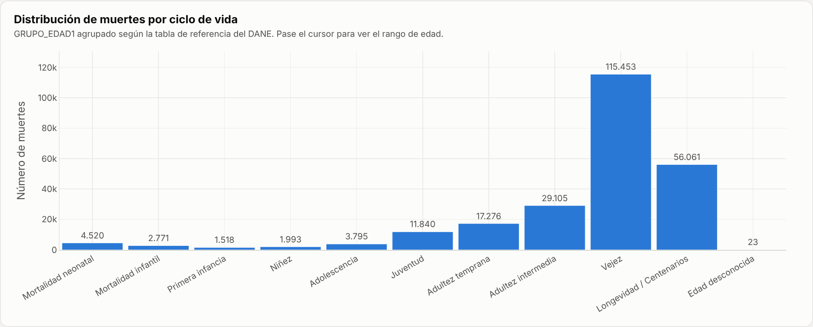

# Mortalidad en Colombia 2019 – Aplicación web interactiva con Dash

**Actividad 4 – Aplicación web interactiva para el análisis de mortalidad en Colombia**
Maestría en Inteligencia Artificial

**Integrantes:**
- Jhon Fredy Pardo Salazar


**Aplicación desplegada:** (https://mortalidad-colombia-2019-66i2.onrender.com/)
**Repositorio:** https://github.com/jhonfredyps-hash/mortalidad-colombia-2019)

---

## 1. Introducción

Esta aplicación web permite explorar de forma visual e interactiva las **244.355 defunciones no fetales** registradas en Colombia durante 2019, según las Estadísticas Vitales (EEVV) del DANE. Está construida en Python con **Pandas** (procesamiento), **Plotly** (gráficos) y **Dash** (aplicación web), y está desplegada en **Render**, una plataforma como servicio (PaaS).

La aplicación reúne en un solo tablero un mapa por departamento, la evolución mensual, las ciudades más violentas, las ciudades con menor mortalidad, las principales causas de muerte, la comparación por sexo y la distribución por ciclo de vida. Además tiene **filtros por departamento y sexo** que actualizan los indicadores y los gráficos.

## 2. Objetivo

Analizar la mortalidad en Colombia en 2019 para identificar **patrones demográficos y regionales**:

- dónde se concentran las muertes (departamentos y municipios);
- cómo varían a lo largo del año;
- cuáles son las principales causas de muerte (CIE-10);
- qué municipios concentran los homicidios por arma de fuego (X95);
- qué diferencias hay entre hombres y mujeres y en qué etapas del ciclo de vida ocurren las muertes.

## 3. Estructura del proyecto

```
mortalidad-colombia-2019/
├── app.py                      # Aplicación Dash: carga de datos, gráficos, layout y callbacks
├── requirements.txt            # Librerías y versiones
├── Procfile                    # Comando de arranque (gunicorn) para PaaS
├── render.yaml                 # Configuración de despliegue en Render (Blueprint)
├── .python-version             # Versión de Python
├── scripts/
│   └── preparar_datos.py       # Limpia y une los Excel del DANE -> CSV comprimidos
├── data/
│   ├── NoFetal2019.xlsx        # Microdatos de defunciones no fetales 2019 (DANE)
│   ├── CodigosDeMuerte.xlsx    # Catálogo de causas de muerte CIE-10
│   ├── Divipola.xlsx           # División político-administrativa (departamentos y municipios)
│   ├── colombia_departamentos.geojson  # Polígonos de departamentos (MGN DANE) para el mapa
│   └── procesado/
│       ├── mortalidad_2019.csv.gz      # Defunciones + nombres de municipio y departamento
│       └── causas_muerte.csv.gz        # Código CIE-10 -> descripción
├── assets/
│   ├── estilos.css             # Estilos de la aplicación (Dash los carga automáticamente)
│   └── topojson/               # Mapas base de Plotly servidos localmente
└── docs/img/                   # Capturas de pantalla usadas en este README
```

**Flujo de datos:** `scripts/preparar_datos.py` lee los tres Excel, normaliza los códigos (`COD_DANE` a 5 dígitos, departamento a 2), une cada defunción con su municipio y departamento (Divipola) y arma el catálogo CIE-10 a 3 y 4 caracteres. El resultado se guarda en CSV comprimido (~2 MB). Así la aplicación arranca en segundos en lugar de leer un Excel de 19 MB en cada inicio. Si los archivos procesados no existen, `app.py` los genera automáticamente.

## 4. Requisitos

- Python 3.11 o superior (probado con 3.13)

| Librería | Versión | Uso |
|---|---|---|
| dash | 4.5.0 | Aplicación web y componentes interactivos |
| plotly | 7.1.0 | Gráficos interactivos |
| pandas | 3.0.5 | Lectura, limpieza y agregación de datos |
| openpyxl | 3.1.5 | Lectura de los archivos Excel |
| gunicorn | 26.2.0 | Servidor WSGI de producción |

## 5. Software

- **Python**: lenguaje de programación
- **Pandas**: manipulación de datos
- **Plotly**: visualización interactiva (mapa coroplético, líneas, barras, circular, histograma)
- **Dash**: framework web (layout, callbacks, `DataTable`)
- **Gunicorn**: servidor de producción
- **Git y GitHub**: control de versiones y repositorio
- **Render**: plataforma como servicio (PaaS) para el despliegue
- **Visual Studio Code**: editor de código

## 6. Instalación (ejecución local)

```bash
# 1. Clonar el repositorio
git clone https://github.com/TU-USUARIO/mortalidad-colombia-2019.git
cd mortalidad-colombia-2019

# 2. Crear y activar un entorno virtual
python -m venv venv
# Windows:
venv\Scripts\activate
# macOS / Linux:
source venv/bin/activate

# 3. Instalar dependencias
pip install -r requirements.txt

# 4. (Opcional) Regenerar los datos procesados desde los Excel del DANE
python scripts/preparar_datos.py

# 5. Ejecutar la aplicación
python app.py
```

Abrir en el navegador: <http://127.0.0.1:8050>

## 7. Despliegue en Render

1. Subir el proyecto a un repositorio **público** de GitHub (`git add .`, `git commit`, `git push`).
2. Crear una cuenta en <https://render.com> e iniciar sesión con GitHub.
3. En el panel, elegir **New → Web Service** y seleccionar el repositorio.
4. Configurar el servicio:
   - **Language / Runtime:** Python 3
   - **Branch:** `main`
   - **Build Command:** `pip install -r requirements.txt`
   - **Start Command:** `gunicorn app:server --bind 0.0.0.0:$PORT --workers 1 --timeout 120`
   - **Instance Type:** Free
   - **Environment Variable:** `PYTHON_VERSION = 3.13.1`
5. Pulsar **Create Web Service**. Render instala las dependencias y arranca la aplicación. Al terminar muestra la URL pública (`https://<nombre>.onrender.com`).
6. Cada `git push` a `main` vuelve a desplegar la aplicación automáticamente.

> Alternativa: como el repositorio incluye `render.yaml`, también se puede usar **New → Blueprint**, que toma toda la configuración de ese archivo.
>
> Nota: en el plan gratuito, el servicio se suspende tras 15 minutos sin uso. La primera visita después puede tardar unos 30–60 segundos en cargar.

Puntos clave del código para el despliegue:

```python
app = Dash(__name__)
server = app.server   # gunicorn usa este objeto: "app:server"
```

## 8. Visualizaciones y explicación de resultados

**Filtros e indicadores.** En la parte superior hay dos filtros: *Departamento* (lista desplegable) y *Sexo* (Todos / Hombres / Mujeres). También hay cuatro indicadores: total de muertes, homicidios por arma de fuego (X95), mes con más muertes y principal causa. Todos los gráficos tienen información emergente (*tooltip*), zoom y descarga como PNG.



### 8.1 Mapa – Muertes por departamento



Mapa coroplético con el total de defunciones por departamento: a mayor número de muertes, más oscuro el azul. **Bogotá D.C. (38.760), Antioquia (34.473) y Valle del Cauca (28.443)** concentran el 41 % de las muertes del país, seguidos por Atlántico (14.804). Esto refleja, sobre todo, el tamaño de su población. Los departamentos de la Orinoquía y la Amazonía (Vaupés 87, Guainía 115, Vichada 188) registran las cifras más bajas, por su baja población y posiblemente por subregistro.

### 8.2 Gráfico de líneas – Muertes por mes



Las defunciones son bastante estables a lo largo del año, entre ~19.000 y ~21.700 por mes. **Diciembre es el mes con más muertes (21.678)**, seguido de julio y enero. **Febrero tiene el mínimo (17.974)**, en parte porque es el mes más corto. No se observan picos extremos, lo que indica que en 2019 no hubo eventos masivos.

### 8.3 Gráfico de barras – Las 5 ciudades más violentas



Se consideran homicidios las muertes con código CIE-10 **X95 (X950–X959)**: agresión con disparo de armas de fuego y casos no especificados. **Santiago de Cali (971)** encabeza la lista con un número muy superior a **Bogotá D.C. (601)**, a pesar de tener cerca de un tercio de su población. Le siguen **Medellín (428), Barranquilla (260) y San José de Cúcuta (206)**. En el país hubo 9.273 muertes por esta causa. El **93,5 % de las víctimas fueron hombres**, la mayoría jóvenes y adultos de 20 a 44 años.

### 8.4 Gráfico circular – Las 10 ciudades con menor mortalidad



Muestra los 10 municipios con menos defunciones registradas en 2019. Hubo **13 municipios con una sola muerte** en todo el año, por lo que el gráfico presenta los primeros 10 en orden alfabético entre los empatados: Alto Baudó y Nuquí (Chocó), Bituima (Cundinamarca), El Calvario (Meta), El Encanto y Puerto Alegría (Amazonas), Hato (Santander), La Tola (Nariño), Mapiripana (Guainía) y Margarita (Bolívar). Son municipios pequeños o áreas no municipalizadas, con poca población y, en algunos casos, posible subregistro. *Nota:* el conjunto de datos no incluye la población de cada municipio, por lo que el índice se calcula con el **número absoluto de muertes** y no con una tasa por habitante.

### 8.5 Tabla – Las 10 principales causas de muerte



La tabla muestra el código CIE-10, su descripción y el total de casos, de mayor a menor. El **infarto agudo del miocardio (I219) es, por amplio margen, la primera causa de muerte (35.088 casos)**. Le siguen la **EPOC** (J449 y J440) y la **neumonía (J189)**. Varios cánceres aparecen en la lista: estómago, pulmón, mama y próstata. La **agresión con disparo de arma de fuego (X954, 4.396)** es la única causa externa (violenta) del top 10. Predominan las enfermedades crónicas no transmisibles.

### 8.6 Gráfico de barras apiladas – Muertes por sexo en cada departamento



En todos los departamentos mueren **más hombres que mujeres**. A nivel nacional, el **55,1 %** de las muertes corresponden a hombres. La brecha es mayor en los departamentos de frontera y de la Orinoquía-Amazonía: **Guaviare (77 % hombres)**, Guainía, Amazonas, Vichada, Putumayo y Arauca (64–68 %). En cambio, es menor en **Bogotá (51,8 %)** y Atlántico (52,5 %). Los casos de sexo indeterminado son muy pocos (93).

### 8.7 Histograma – Distribución por ciclo de vida (GRUPO_EDAD1)



Los códigos `GRUPO_EDAD1` se agruparon según la tabla de referencia del DANE (neonatal 0–4, infantil 5–6, …, centenarios 25–28, desconocida 29). La mortalidad se concentra en la **vejez, de 60 a 84 años (47,2 %)**, y en **85 años o más (22,9 %)**. Esto coincide con el peso de las enfermedades crónicas. Aun así, la **mortalidad neonatal (1,8 %)** supera a la de la niñez y la primera infancia. También se nota un aumento en **juventud y adultez temprana**, impulsado por las causas violentas.

## 9. Conclusiones

- La mortalidad en Colombia en 2019 está dominada por **enfermedades crónicas** (cardiovasculares, respiratorias y cáncer) en personas mayores de 60 años.
- La **violencia con armas de fuego** es la principal causa externa. Afecta sobre todo a **hombres jóvenes** y se concentra en **Cali**, seguida por Bogotá y Medellín.
- La distribución territorial sigue a la población: Bogotá, Antioquia y Valle concentran la mayoría de las muertes.
- El comportamiento mensual es estable. Diciembre presenta el máximo y febrero el mínimo.

## 10. Fuentes

- DANE – Estadísticas Vitales (EEVV) 2019, defunciones no fetales: <https://microdatos.dane.gov.co/> (catálogo "Estadísticas Vitales - EEVV - 2019")
- Clasificación Internacional de Enfermedades CIE-10 (catálogo DANE)
- DIVIPOLA – División Político-Administrativa de Colombia (DANE)
- Marco Geoestadístico Nacional (MGN) 2018 – DANE, para los polígonos del mapa
